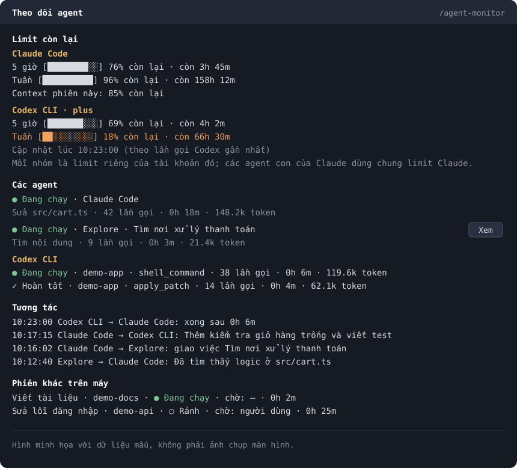

# Agent Monitor

Mod cho Claude Code: một văn phòng pixel art nằm cạnh khung chat, nơi **Claude Code**, **Codex CLI** và các subagent là những nhân vật đang làm việc, nhắn tin cho nhau, và bạn thấy luôn **mỗi bên còn bao nhiêu limit**.



*Hình do chính mod vẽ từ dữ liệu mẫu.*

## Tính năng

**Văn phòng trực quan**
- Mỗi agent là một nhân vật có ngoại hình cố định. Claude Code mặc áo khoác đất nung, Codex CLI mặc hoodie tối, subagent đeo thẻ.
- Đang chạy thì ngồi gõ phím ở bàn, cần bạn thì giơ tay với dấu `?`, lỗi thì hiện `!`, xong việc thì ra khu nghỉ.
- Thư bay giữa các nhân vật khi chúng giao việc hoặc nhắn nhau. Di chuột lên nhân vật để xem tên và việc đang làm.
- Bên dưới là thẻ tổng chi phí Claude, token, thời gian, và thẻ riêng cho từng agent.
- Trên terminal không vẽ được SVG, nên pane hiển thị dạng chữ.

**Limit riêng cho từng agent**
- Claude Code: limit 5 giờ, limit tuần, thời gian đến lúc reset, và context còn lại của phiên.
- Codex CLI: limit 5 giờ, limit tuần, gói đang dùng, và thời điểm số liệu được cập nhật.
- Tất cả tính theo phần trăm **còn lại**. Dòng đổi màu khi còn dưới 20% và dưới 5%.
- Mỗi nhân vật có thanh limit trên đầu, lấy theo cửa sổ gần cạn nhất của tài khoản nó dùng. Mỗi thẻ agent ghi limit 5 giờ, limit tuần và phần token agent đó chiếm.
- Claude và Codex chỉ cấp limit theo tài khoản, nên các agent cùng tài khoản hiện cùng con số; điểm khác nhau là phần token đã dùng.

**Tiến trình**
- Agent chính và các subagent của Claude, hiển thị lồng theo quan hệ cha con: trạng thái, công cụ đang chạy, số lần gọi, thời gian, token đã dùng. Nút **Xem** mở transcript của subagent.
- Các lần chạy Codex CLI do chính phiên này gọi (qua MCP hoặc `codex exec`): đang chạy hay đã xong, thư mục làm việc, công cụ gần nhất, số lần gọi, token.
- Pane chỉ hiện việc của phiên đang mở. Limit vẫn là số của cả tài khoản.

**Tương tác**
- Dòng thời gian mới nhất lên trước: Claude giao việc cho Codex, Codex trả kết quả (xong, lỗi, hết giờ chờ MCP), subagent được tạo, agent nhắn tin cho nhau, agent kết thúc.

## Cài đặt

Tại prompt của một phiên terminal:

```
/plugin install agent-monitor --marketplace TheFatMan2108/agent-monitor
```

Từ shell:

```bash
claude plugin install agent-monitor --marketplace TheFatMan2108/agent-monitor
```

Trong ứng dụng desktop, nơi `/plugin` không chạy: bấm **+** cạnh ô nhập, chọn **Plugins**, **Add marketplace** với `TheFatMan2108/agent-monitor`, rồi **Add plugin**.

## Sử dụng

Pane tự mở khi phiên bắt đầu. Nếu đã đóng, gõ `/agent-monitor` để mở lại.

## Nguồn dữ liệu và quyền riêng tư

Mod chỉ quan sát, không chặn hay sửa bất kỳ lệnh gọi nào. Mod không gọi model, nên không tốn limit, và không kết nối mạng.

| Dữ liệu | Lấy từ |
| --- | --- |
| Limit và context của Claude | API của Claude Code (`$.session.usage`) |
| Subagent, công cụ, tin nhắn | Sự kiện trong phiên Claude hiện tại |
| Limit và tiến trình Codex | `~/.codex/sessions/**/rollout-*.jsonl` (hoặc `CODEX_HOME`) |

- Không đọc `auth.json` hay `config.toml`.
- Từ log Codex chỉ lấy tên công cụ, trạng thái, số token, số liệu limit và tên thư mục. Không lưu nội dung hội thoại, tham số hay kết quả công cụ.
- Feed lưu tối đa 120 ký tự đầu của tin nhắn hoặc task, và chỉ trong bộ nhớ của phiên.

## Hạn chế

- Thanh chạy dưới mỗi agent chỉ báo agent đang hoạt động, không phải phần trăm tiến độ, vì các agent không báo số liệu này. Chi phí chỉ tính cho Claude.
- Limit Codex chỉ cập nhật khi Codex thực sự gọi API. Sau giờ reset, pane báo đã reset thay vì giữ con số cũ.
- Log Codex không ghi nó thuộc phiên Claude nào, nên mod ghép theo thời điểm gọi (từ 5 giây trước đến 90 giây sau) và thư mục làm việc. Hai phiên gọi Codex gần như cùng lúc mà không rõ thư mục có thể bị ghép nhầm. Codex chạy ngoài phiên, hoặc trước khi mod được nạp, sẽ không hiện.
- Định dạng log của Codex không phải API công khai, nên có thể thay đổi theo phiên bản. Khi không đọc được, phần Codex sẽ ẩn hoặc báo chưa có dữ liệu, không ảnh hưởng phiên làm việc.
- Limit của Claude chỉ có với gói subscription và sau lượt gọi API đầu tiên.
- Dòng Claude giao việc cho Codex chỉ ghi nhận khi gọi qua MCP `codex-cli`. Lần chạy `codex exec` trực tiếp vẫn hiện ở mục tiến trình.

## Phát triển

```bash
claude plugin validate .
claude plugin test .
```
